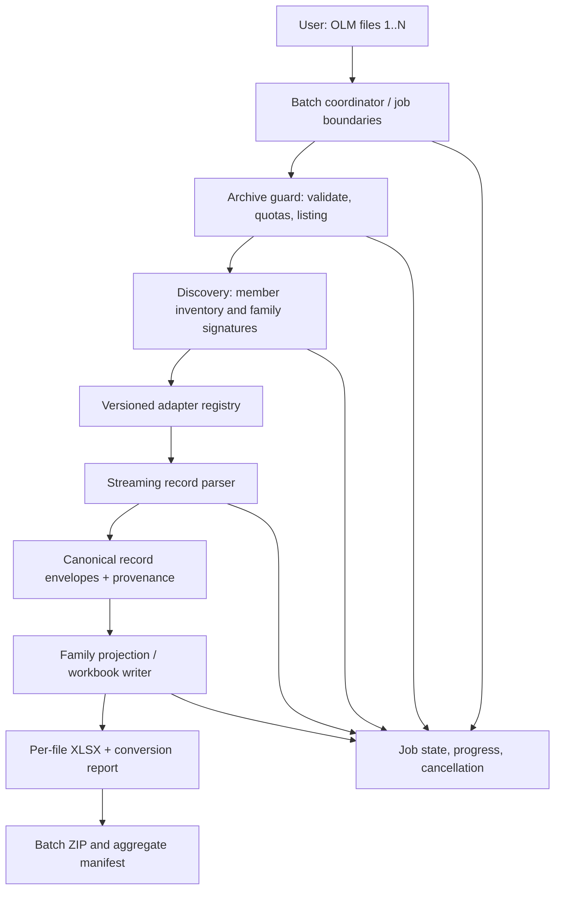

# 03 — Target System Architecture

Status: PROPOSED; not an implementation claim.

## System boundary
A standalone, local-first application accepts user-selected OLM files and produces XLSX and diagnostics. The engine has no dependence on the parent Streamlit monolith or its requirements. UI and CLI consume the same core API.

## Boundaries and owners
| Boundary | Producer → consumer | Contract | Failure/ownership |
|---|---|---|---|
| Upload | UI/CLI → coordinator | read-only file handles, opaque job IDs, limits | adapter owns no upload session state |
| Inspection | guard → discovery | safe indexed member descriptors with sizes/hashes | guard rejects unsafe ZIP before parse |
| Selection | discovery → adapter registry | signatures + confidence + version, no filename-only assertion | registry rejects ambiguity/unsupported |
| Extraction | adapter → canonical stream | records, identities, typed fields, unknowns and source locators | adapter is accountable for claimed coverage |
| Projection | canonical stream → XLSX | normalized sheets, safe cell policies and stable naming | writer enforces Excel constraints |
| Completion | writer → batch collector | immutable result manifest and outcome state | coordinator owns aggregation/retry/cancel |

## Control-plane and data-plane separation
Control: jobs, limits, fingerprints, statuses, progress, cancellation, adapter choices, warnings, errors and output manifests.
Data: original read-only archives, bounded member streams, parsed records, spool files if required, XLSX/ZIP artifacts.
Do not send raw contacts or message bodies through observability or control events.

## Components
- `core/archive_guard.py`: validate container integrity, quotas, duplicate filenames, compression ratios, path traversal, symlinks and nested archive policy; no unsafe extraction.
- `core/discovery.py`: detect family/namespace/schema fingerprints; inventory unsupported payloads.
- `adapters/`: independently versioned readers for proven OLM variants and record families; capability declarations.
- `core/records.py`: immutable canonical envelope + typed values + raw unknown references.
- `core/projection.py`: normalized family views and overflow mapping without semantic guessing.
- `core/xlsx_writer.py`: streaming or write-only workbook writer; workbook constraints and guard against formula execution.
- `core/coordinator.py`: bounded sequential/default-concurrency processing, deterministic job outcomes.
- `interfaces/cli.py` and `interfaces/ui.py`: thin presentation adapters only.
- `core/report.py`: coverage manifest, field/record anomalies, provenance and traceability.
Names and layout are proposals, not preexisting paths.

## End-to-end behavior
1. Intake assigns unique job ID for each upload; computes input digest without modifying source.
2. Guard validates ZIP signature, members and quotas before or during bounded streaming.
3. Discovery enumerates member signatures and matches registry declarations; ambiguity yields UNSUPPORTED/PARTIAL, never guessed extraction.
4. Adapter emits envelopes with source family, source locator and typed field collections; parse failures preserve record-level diagnostics.
5. Projection maps families to sheets and child tables. Unknown values receive a loss inventory and optional raw-safe diagnostic extract.
6. Workbook is written to a temporary isolated artifact; roundtrip structure and counts verified; only then atomically marked downloadable.
7. Batch aggregator collects independent outcomes, per-file XLSX and manifest into ZIP; retries never overwrite another input’s artifact.

## State machine
QUEUED → VALIDATING → DISCOVERING → CONVERTING → VERIFYING → {SUCCESS, PARTIAL, FAILED, UNSUPPORTED, CANCELLED}.
Only terminal results with verified artifact integrity may be downloadable. PARTIAL must include limitations manifest.

## Scaling and time
Default bounded sequential conversion protects memory; concurrency is opt-in by measurable limits. Per-file progress is based on bytes processed and records emitted, not fake percentages. Time/size thresholds are governed by measurement, not hardcoded in this document.

## Trust boundary
OLM is untrusted. XML and ZIP must be hardened before traversing. UI must never expose native paths or raw stack traces. Output spreadsheet is potentially active content; treat field values as untrusted strings.

## Evolution
Add adapters, not hardcoded path guesses in shared core. Registry metadata declares format signatures, supported families, tested fixture versions and coverage level. New record types require PRD/contract and golden fixture updates before marking supported.
